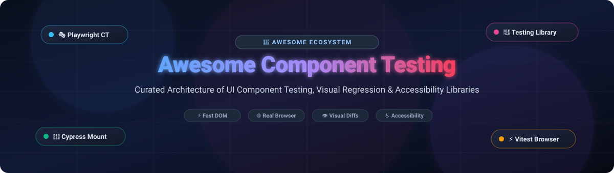

# Awesome Component Testing Libraries 🧪✨

<div align="center">



<br/><br/>

<a href="https://github.com/ishandutta2007/Awesome-Awesome-Awesome"></a><a href="https://discord.gg/jc4xtF58Ve"></a>
[](https://opensource.org/licenses/MIT)
[](http://makeapullrequest.com)
<a href="https://github.com/ishandutta2007"></a>

<p align="center">
  <b>A curated list of delightfully modern Component Testing Libraries, Real-Browser Harnesses, Visual Regression Testing Tools, and Accessibility Checkers.</b><br/>
  <i>Engineered for frontend developers, QA architects, and UI engineers building resilient design systems and production web apps.</i>
</p>

</div>

---

## 📑 Table of Contents
- [📖 Sector Overview & Market Dynamics](#-sector-overview--market-dynamics)
- [☁️ SaaS & Hosted Platforms](#️-saas--hosted-platforms)
- [🐙 Open-Source GitHub Projects](#-open-source-github-projects)
- [🧩 Framework Synergy & Architecture Guide](#-framework-synergy--architecture-guide)
- [🤝 How to Contribute](#-how-to-contribute)
- [💖 Support](#-support)
- [📈 Star History](#-star-history)
- [⚖️ Disclaimer](#️-disclaimer)

---

## 📖 Sector Overview & Market Dynamics

The global automated software testing and visual UI regression sector represents an estimated addressable market of **$28 billion to $35 billion by 2026** (expanding at an ~18% CAGR), driven by continuous delivery pipelines, micro-frontends, and component design systems. The market is **moderately fragmented yet bifurcated**: core execution and test runners are dominated by open-source standards (Playwright, Cypress, Vitest, Testing Library), whereas specialized cloud-hosted infrastructure—such as multi-browser visual AI diffing and distributed cloud test grids—is concentrated among dominant infrastructure players like BrowserStack (Percy) and Applitools.

---

## ☁️ SaaS & Hosted Platforms

| SaaS Product 🛠️ | Company Size / Valuation 🏢 | Pricing (Starting Tier) 💵 | Free Tier / Free Trial Limits 🎁 | Description 📝 |
| :--- | :--- | :--- | :--- | :--- |
| **[Percy](https://percy.io/)** | **BrowserStack** (Valuation: ~$4.0B+, Revenue: ~$250M+ ARR) | **$99/month** (Desktop plan) | **5,000 free screenshots/month** with unlimited team members on Free plan | Visual testing and review platform for web apps and component libraries. Captures DOM snapshots and renders pixel-perfect visual diffs across browsers. |
| **[Chromatic](https://www.chromatic.com/)** | **Storybook / Chromatic Inc.** (Valuation: ~$150M - $250M, Series A/Growth) | **$149/month** (Starter plan) | **5,000 free snapshots/month** forever + unlimited snapshots for public open-source repos | Automated visual regression testing, UI review workflows, and component publishing purpose-built for Storybook and Figma setups. |
| **[Applitools](https://applitools.com/)** | **Applitools Ltd.** (Valuation: ~$100M - $150M / ~$35M+ ARR) | **$90/month** (Starter tier) | **100 free visual checkpoints/month** forever on the Free Starter plan (or 14-day Enterprise Trial with 1,000 checkpoints) | Enterprise visual AI testing platform using computer vision and machine learning to validate visual regressions without fragile DOM noise. |

---

## 🐙 Open-Source GitHub Projects

The premier open-source libraries for component testing, unit isolation, accessibility audits, and real-browser rendering, sorted by community adoption (GitHub star counts descending):

| Repository 📦 | Stars ⭐ | Primary Focus 🎯 | License 📜 | Description 📝 |
| :--- | :---: | :--- | :---: | :--- |
| **[Playwright](https://github.com/microsoft/playwright)** | [](https://github.com/microsoft/playwright/stargazers) | Real-Browser Component & E2E Testing | Apache-2.0 | High-velocity component testing for React, Vue, Svelte, and solid components in Chromium, Firefox, and WebKit with native parallel processes and timeline traces. |
| **[Storybook](https://github.com/storybookjs/storybook)** | [](https://github.com/storybookjs/storybook/stargazers) | Isolated Component Workshop & Testing | MIT | Industry-standard frontend workshop for developing UI components in isolation, featuring interaction tests via `play` functions and portable stories. |
| **[Cypress](https://github.com/cypress-io/cypress)** | [](https://github.com/cypress-io/cypress/stargazers) | Real-Browser Component Runner | MIT | Mature real-browser component testing mounting JSX/SFC components inside Chromium, Firefox, or Electron with live time-travel debugging. |
| **[Jest](https://github.com/jestjs/jest)** | [](https://github.com/jestjs/jest/stargazers) | Universal Test Runner & Snapshots | MIT | Delightful JavaScript testing framework featuring snapshot testing, parallel worker execution, flexible mocking utilities, and jsdom runtime integration. |
| **[Enzyme (Legacy)](https://github.com/enzymejs/enzyme)** | [](https://github.com/enzymejs/enzyme/stargazers) | Legacy React Component Testing | MIT | Historical JavaScript testing utility for React (deprecated; incompatible with React 18+; recommended to migrate to React Testing Library). |
| **[React Testing Library](https://github.com/testing-library/react-testing-library)** | [](https://github.com/testing-library/react-testing-library/stargazers) | User-Centric React DOM Assertions | MIT | Gold-standard React component testing library built around the guiding principle: "The more your tests resemble the way your software is used, the more confidence they give you." |
| **[MSW (Mock Service Worker)](https://github.com/mswjs/msw)** | [](https://github.com/mswjs/msw/stargazers) | Network-Level API Mocking | MIT | Seamless API mocking via Service Workers in browsers and Node.js interceptors, ensuring components execute real un-mocked HTTP fetch/XHR flows. |
| **[Vitest](https://github.com/vitest-dev/vitest)** | [](https://github.com/vitest-dev/vitest/stargazers) | Vite-Native Test Runner & Browser Mode | MIT | Blazing-fast Vite-native testing framework with out-of-the-box ESM, TypeScript, HMR, Jest-compatible APIs, and headless browser mode. |
| **[WebdriverIO](https://github.com/webdriverio/webdriverio)** | [](https://github.com/webdriverio/webdriverio/stargazers) | Next-Gen Browser & Mobile Automation | MIT | Flexible automation test framework supporting W3C WebDriver, Chrome DevTools Protocol, and native mobile testing for component suites. |
| **[TestCafe](https://github.com/DevExpress/testcafe)** | [](https://github.com/DevExpress/testcafe/stargazers) | Zero-Config Node.js Browser Testing | MIT | Node.js web testing tool requiring zero WebDriver installations or browser plugins, providing built-in smart waits and selector helpers. |
| **[Testing Library (DOM Core)](https://github.com/testing-library/dom-testing-library)** | [](https://github.com/testing-library/dom-testing-library/stargazers) | Accessible DOM Queries Core | MIT | The foundation of the Testing Library family, offering accessibility-driven queries (`getByRole`, `getByLabelText`, `getByText`) mirroring assistive technologies. |
| **[jest-dom](https://github.com/testing-library/jest-dom)** | [](https://github.com/testing-library/jest-dom/stargazers) | Semantic DOM Matchers | MIT | Custom Jest & Vitest matchers (`toBeInTheDocument`, `toBeVisible`, `toBeDisabled`) that make UI test assertions readable, concise, and declarative. |
| **[user-event](https://github.com/testing-library/user-event)** | [](https://github.com/testing-library/user-event/stargazers) | Realistic User Interaction Simulation | MIT | Simulates realistic browser interactions dispatching sequential events (`pointerdown`, `focus`, `keydown`, `click`) rather than synthetic triggers. |
| **[Cypress Testing Library](https://github.com/testing-library/cypress-testing-library)** | [](https://github.com/testing-library/cypress-testing-library/stargazers) | Testing Library Queries in Cypress | MIT | Enhances Cypress with user-centric `cy.findByRole()`, `cy.findByLabelText()` queries, unifying testing philosophy across unit and E2E suites. |
| **[Safetest](https://github.com/kolodny/safetest)** | [](https://github.com/kolodny/safetest/stargazers) | Full-App Component Testing | MIT | Unifies Playwright and Jest/Vitest to test complex React applications in real browsers while retaining direct programmatic access to application states. |
| **[jest-axe](https://github.com/nickcolley/jest-axe)** | [](https://github.com/nickcolley/jest-axe/stargazers) | Automated a11y Testing for Jest | MIT | Integrates Deque's `axe-core` accessibility engine into Jest to automatically detect ARIA violations, missing labels, and contrast defects in components. |
| **[Storybook Test Runner](https://github.com/storybookjs/test-runner)** | [](https://github.com/storybookjs/test-runner/stargazers) | CI Storybook Assertion Runner | MIT | Standalone test runner powered by Playwright that executes interaction tests and a11y validations across all Storybook stories in CI environments. |
| **[Playwright Testing Library](https://github.com/testing-library/playwright-testing-library)** | [](https://github.com/testing-library/playwright-testing-library/stargazers) | Testing Library Queries in Playwright | MIT | Extensions adding accessibility-first DOM query locators to Playwright browser sessions and component fixtures. |
| **[vitest-axe](https://github.com/chaance/vitest-axe)** | [](https://github.com/chaance/vitest-axe/stargazers) | Automated a11y Testing for Vitest | MIT | Clean Vitest wrapper around `axe-core` matchers for streamlined accessibility regression testing in Vite ecosystems. |

---

## 🧩 Framework Synergy & Architecture Guide

Building an enterprise-ready UI component test matrix typically combines complementary open-source and hosted tools:

```
[ Component Isolation & Stories ]  ──>  Storybook
[ Fast DOM Unit Assertions ]       ──>  React Testing Library + vitest / jest + jest-dom
[ Real-Browser Layout & CSS ]      ──>  Playwright Component Testing / Cypress Mount
[ Network Isolation & Mocks ]      ──>  MSW (Mock Service Worker)
[ Accessibility Guardrails ]       ──>  jest-axe / vitest-axe
[ Cross-Browser Visual Diffs ]     ──>  Percy / Chromatic / Applitools
```

---

## 🤝 How to Contribute

Contributions are wholeheartedly welcome! ✨

1. 🍴 Fork the repository.
2. 🌿 Create a descriptive branch: `git checkout -b add-new-testing-lib`.
3. 📝 Add or edit entries in `README.md` maintaining the sorting, tabular format, specific pricing, and badge conventions.
4. 🚀 Open a Pull Request with a clear description of the library and its role in frontend testing.

---

## 💖 Support

Thank you for exploring this curated repository! If you find this project valuable for your testing workflows, please consider showing your support:

- ⭐ **Star this repository** to help other frontend and QA engineers discover it.
- 🍴 **Fork and contribute** your favorite component testing patterns and tools.
- 📢 **Share with peers** across social channels, Discord, and engineering teams.
- ☕ **Buy me a coffee**: If you'd like to sponsor the ongoing curation of this and other open-source developer lists, visit the [GitHub Sponsors Dashboard](https://github.com/sponsors/ishandutta2007).

---

## 📈 Star History

[](https://star-history.dera.page/#ishandutta2007/Awesome-Component-Testing-Libraries&type=date&legend=top-left)

---

## ⚖️ Disclaimer

- This is a community-curated collection intended for educational and engineering benchmarking purposes; inclusion does not constitute commercial endorsement.
- All trademarks, logos, and brand names belong to their respective owners.
- When configuring automated testing pipelines, ensure test suites adhere to security best practices and never expose production secrets or authentication keys in test mock files.

---

<div align="center">
  <sub>Crafted with care for frontend developers, QA engineers, and open-source contributors worldwide. 🌍💻</sub>
</div>
